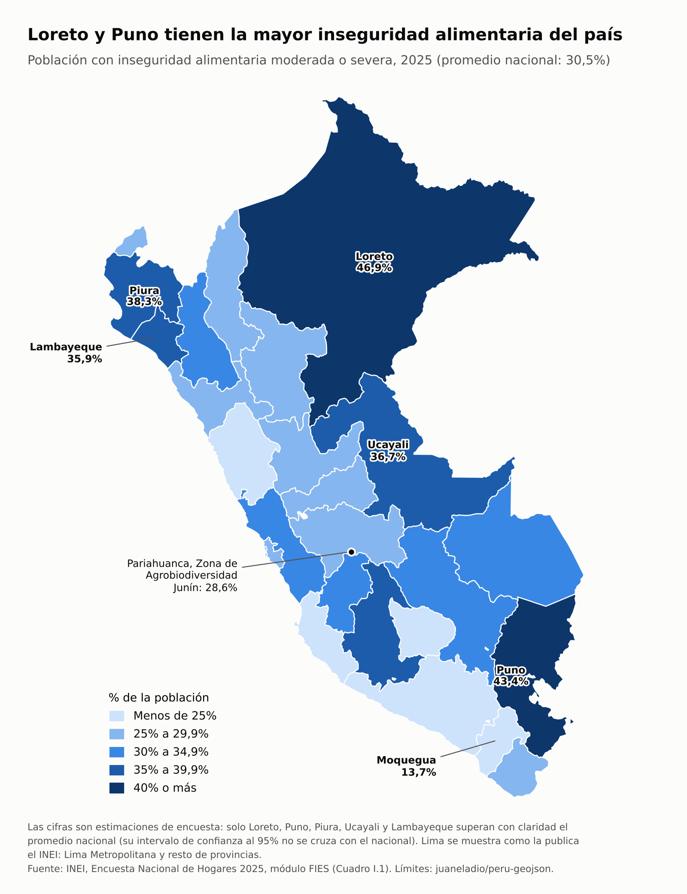

# Inseguridad alimentaria en el Perú, 2025

Mapa de la población con inseguridad alimentaria moderada o severa por departamento. Sobre el mapa se ubican las doce Zonas de Agrobiodiversidad reconocidas por el Midagri. [Fuente](https://www.gob.pe/institucion/inia/noticias/888597-inia-implementa-plataforma-web-de-zonas-de-agrobiodiversidad-del-peru-zabd-peru).



## Qué muestra

- En 2025, el 30,5% de la población vivió inseguridad alimentaria moderada o severa.
- Loreto (46,9%) y Puno (43,4%) tienen las cifras más altas; Moquegua (13,7%), la más baja.
- Solo cinco departamentos superan con claridad el promedio nacional: Loreto, Puno, Piura, Ucayali y Lambayeque. "Con claridad" significa que su intervalo de confianza al 95% no se cruza con el nacional; es una regla práctica, no una prueba estadística formal.
- El mapa ubica las doce Zonas de Agrobiodiversidad reconocidas por el Midagri a junio de 2026 y destaca Pariahuanca (Huancayo, Junín). Cada punto marca el distrito donde está la zona, no sus límites.
- La ENAHO no da cifras por distrito: para Pariahuanca se muestra el dato del departamento de Junín (28,6%).
- Cinco de las doce zonas están en Apurímac, uno de los departamentos con menos inseguridad alimentaria (20,2%). El mapa no muestra una coincidencia simple entre agrobiodiversidad y hambre.

## Cómo reproducirlo

```bash
pip install -r requirements.txt
python mapa_inseguridad_alimentaria.py
```

El script descarga los límites departamentales y provinciales la primera vez y guarda el mapa en `salida/` (PNG y SVG).

## Datos

`datos/inei_fies_2025_departamentos.csv` tiene una fila por ámbito departamental:

| Columna | Contenido |
| --- | --- |
| `ubigeo_dep`, `clave_mapa` | Código del departamento y clave de unión con la capa del mapa |
| `ia_mod_sev_pct` | Inseguridad alimentaria moderada o severa (% de la población) |
| `ic95_inf`, `ic95_sup`, `cv_pct` | Intervalo de confianza al 95% y coeficiente de variación |
| `frente_al_nacional` | Si el intervalo queda por encima, por debajo o no se distingue del nacional |
| `grupo_ia_severa`, `ia_severa_grupo_inf`, `ia_severa_grupo_sup` | Grupo de inseguridad severa del INEI y su rango |

El INEI publica Lima en tres ámbitos (Lima Metropolitana, Callao y resto de provincias), y el mapa los dibuja por separado.

`datos/zonas_agrobiodiversidad.csv` tiene una fila por zona: nombre, departamento, provincia, distrito, ubigeo y las coordenadas de un punto dentro del distrito (calculado con la capa distrital de la misma fuente de límites). Ccollasuyo y Marcapata-Ccollana comparten distrito (Marcapata), y la zona Andahuaylas abarca Chiara y San Miguel de Chaccrampa.

## Fuentes

- INEI, [Prevalencia de Inseguridad Alimentaria 2025](https://www.gob.pe/institucion/inei/informes-publicaciones/8256358-prevalencia-de-inseguridad-alimentaria-2025), cuadros I.1 e I.3 del anexo estadístico.
- Zonas de Agrobiodiversidad: resoluciones ministeriales del Midagri; lista vigente según [El Peruano, junio de 2026](https://elperuano.pe/noticia/297699-apurimac-reconocen-a-justo-apu-sahuaraura-como-duodecima-zona-de-agrobiodiversidad).
- Límites: [juaneladio/peru-geojson](https://github.com/juaneladio/peru-geojson).

Elaborado por Antuané Vera para el curso de Salud con Lupa y FOVIDA sobre seguridad alimentaria, agrobiodiversidad y cambio climático.
